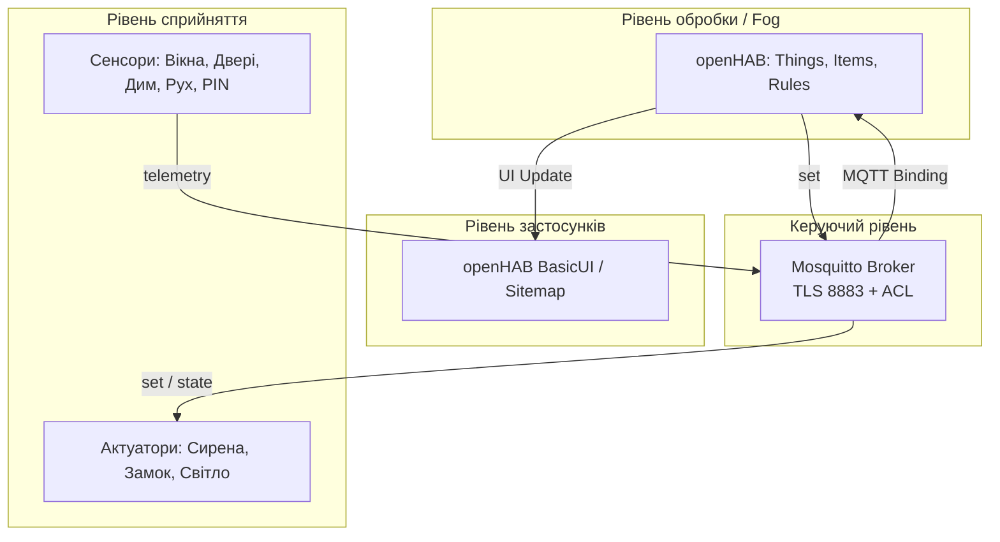

# Модульний контроль 1: Охоронна система приватного будинку

**Студент:** Кононенко Максим Русланович
**Група:** ІК-41
**Варіант:** 3

🎥 **https://drive.google.com/file/d/1ddx6l6BJnNFHQYa5WyPm1fLPhOWaAh4Q/view?usp=drive_link**

## Опис системи
Система призначена для охорони дверей, вікон і подвір'я з режимами «Вдома» та «Охорона». Забезпечує контроль проникнення, пожежну евакуацію та автоматичне освітлення території.

## Архітектура
Система побудована за чотирирівневою архітектурою IoT.

### Обгрунтування обробки даних
Обробка даних відбувається на рівні **Fog** (сервер openHAB). Для охоронної системи це критично важливо, оскільки забезпечує мінімальну затримку (Наприклад миттєво вмикає сирену), незалежність від інтернет-з'єднання та високий рівень приватності.

### Чому обрано MQTT
MQTT обрано через його легковажність та підтримку постійного з'єднання, що ідеально підходить для моніторингу статусу сенсорів. Використання механізму **Last Will** дозволяє миттєво фіксувати відключення датчика, а **QoS 1/2** гарантує доставку тривожних сигналів. На відміну від HTTP, MQTT підтримує зручний двосторонній зв'язок без постійних запитів, а на відміну від CoAP, має вбудовану надійність на рівні TCP, що критично для систем безпеки.

## Структура пристроїв та топіків
| Пристрій | Тип | Топік телеметрії/команд | Топік статусу |
| :--- | :--- | :--- | :--- |
| **Головні двері** | Сенсор | `house/doors/main/telemetry` | `.../status` |
| **Вікно 1** | Сенсор | `house/windows/w1/telemetry` | `.../status` |
| **Датчик диму** | Сенсор | `house/hall/smoke/telemetry` | `.../status` |
| **Клавіатура** | Сенсор | `house/hall/keypad/telemetry` | `.../status` |
| **Рух на подвір'ї** | Сенсор | `house/yard/motion/telemetry` | `.../status` |
| **Сирена** | Актуатор | `house/hall/siren/set` | `.../status` |
| **Замок дверей** | Актуатор | `house/doors/lock/set` | `.../status` |
| **Світло подвір'я** | Актуатор | `house/yard/light/set` | `.../status` |

## Опис правил автоматизації
1. **Проникнення:** Якщо відкриваються двері або вікно, дається 10 секунд на введення правильного PIN-коду з клавіатури. Якщо код не введено — вмикається сирена.
2. **Пожежна евакуація:** За умови виявлення диму негайно вмикається сирена та розблоковується електронний замок дверей для вільного виходу, незалежно від поточного режиму охорони.
3. **Нічне освітлення:** Якщо зафіксовано рух на подвір'ї у проміжку з 22:00 до 06:00, світло вмикається на 10 секунд, після чого автоматично вимикається.

## Модель загроз STRIDE
| Категорія | Загроза | Заходи протидії |
| :--- | :--- | :--- |
| **S**poofing | Підміна сенсора для зняття з охорони. | Індивідуальні логіни та паролі для кожного клієнта. |
| **T**ampering | Зміна даних телеметрії в локальній мережі. | TLS-шифрування для всіх повідомлень. |
| **R**epudiation | Неможливість довести, хто змінив режим охорони. | Логування подій та змін станів на сервері openHAB. |
| **I**nformation Disclosure| Перехоплення PIN-коду зловмисником. | Передача виключно через зашифрований TLS-канал. |
| **D**enial of Service | Флуд брокера для блокування роботи системи. | Вимкнено анонімний доступ, неавторизовані з'єднання відкидаються. |
| **E**levation of Privilege| Компрометований сенсор намагається відчинити замок. | Суворий ACL: сенсори не мають прав доступу до топіків актуаторів. |

## Інструкція із запуску
1. Склонувати репозиторій.
2. Підняти інфраструктуру: docker compose up -d
3. Запустити симулятори: python3 simulator/devices.py
4. Для перевірки автоматизації запустити сценарій: python3 simulator/devices.py --scenario break_in (smoke, break_in, motion, pin).
